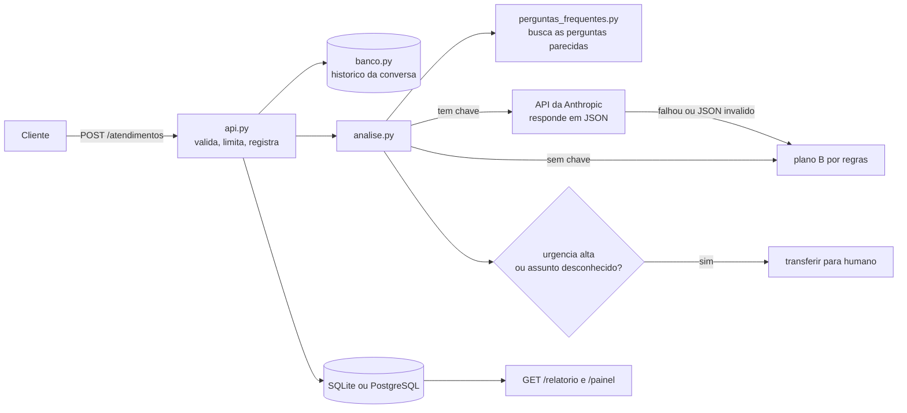

# Agente de Atendimento com IA


API REST em Python que simula um agente de atendimento ao cliente de uma loja virtual (a Loja Aurora, fictícia), parecido com os chatbots que a Blip constrói. Ele entende a mensagem com IA, consulta uma base de perguntas frequentes e responde. Também lembra da conversa, passa para um humano quando precisa e gera relatórios com SQL. Tem uma página de chat e um painel para testar no navegador.

**Demo no ar:** _(link entra aqui depois do deploy no Render)_

## O que ele faz
1. **Entende a mensagem** com IA (API REST da Anthropic). Descobre a intenção (rastreio, troca, pagamento, suporte, elogio, cancelamento, dúvida frequente ou outro) e a urgência (baixa, média ou alta).
2. **Consulta as perguntas frequentes da loja** antes de responder e manda as mais parecidas para a IA, que só pode usar essas informações. Isso evita respostas inventadas.
3. **Lembra da conversa**: as últimas 6 mensagens de cada `conversa_id` vão junto para a IA.
4. **Transfere para humano** quando a urgência é alta ou o assunto não foi entendido.
5. **Guarda tudo em banco SQL**: SQLite por padrão, ou PostgreSQL se a variável `DATABASE_URL` existir.
6. **Mostra um painel** (`/painel`) com total de atendimentos, % para humano e contagem por intenção e urgência, protegido por chave.
7. **Não fica fora do ar**: se não houver chave, ou se a IA falhar ou devolver algo inválido, um plano B por regras responde no lugar. O motivo da falha vai para o log.
8. **Protege os dados**: as rotas com dados de clientes exigem uma chave, o envio de mensagens tem limite por minuto por IP e o texto do cliente não vai para o log.

## Como funciona


## O que este projeto mostra
| Habilidade | Onde está no projeto |
|---|---|
| Python | código todo; funções pequenas, cada arquivo com uma responsabilidade |
| SQL e banco de dados | `banco.py`: `INSERT ... RETURNING`, `GROUP BY`, `COUNT`, filtros; o mesmo SQL roda no SQLite e no PostgreSQL |
| APIs REST | `api.py` (FastAPI) expõe a API; `analise.py` consome a API REST da Anthropic com `requests` |
| IA aplicada | prompt com regras da loja, saída em JSON validada, base de conhecimento (perguntas frequentes), plano B |
| Testes automatizados | `testes/`: mais de 60 testes com pytest, incluindo a IA simulada e o PostgreSQL |
| Git e GitHub | commits pequenos por assunto; GitHub Actions roda os testes a cada push |
| Segurança | chave nas rotas de dados, limite por minuto, texto do cliente tratado como dado no prompt, logs sem dados pessoais |
| Deploy | `Dockerfile` e `render.yaml` para publicar no Render |

## Tecnologias
Python 3 · FastAPI · SQL (SQLite e PostgreSQL) · API REST (`requests`) · pytest · GitHub Actions · Docker · Render

## Como rodar
```bash
git clone https://github.com/matheuswilton/Atendente-IA
cd Atendente-IA
pip install -r requirements.txt
python atendente.py demo          # demonstração no terminal
uvicorn api:app --reload          # API, chat em http://localhost:8000 e painel em /painel
```
Documentação interativa da API: `http://localhost:8000/docs`

### Variáveis de ambiente
| Variável | Para quê | Obrigatória |
|---|---|---|
| `ANTHROPIC_API_KEY` | liga a IA (sem ela, o plano B por regras responde) | não |
| `CHAVE_DO_SERVICO` | protege `/atendimentos` (GET), `/relatorio` e os dados do `/painel` com o cabeçalho `x-chave` | recomendada em produção |
| `DATABASE_URL` | usa PostgreSQL no lugar do SQLite (os dados não somem quando o servidor reinicia) | não |
| `BANCO_ATENDIMENTOS` | caminho do arquivo SQLite (padrão `atendimentos.db`) | não |
| `LIMITE_POR_MINUTO` | mensagens por minuto por IP (padrão 10) | não |
| `NIVEL_DO_LOG` | detalhe do log: `DEBUG`, `INFO` (padrão), `WARNING` | não |

A chave fica só no seu computador ou no painel do Render, nunca no código:
```bash
# Windows (PowerShell)
$env:ANTHROPIC_API_KEY="sua-chave"
# Linux/Mac
export ANTHROPIC_API_KEY="sua-chave"
```

## Endpoints
| Método | Rota | O que faz | Exige chave |
|---|---|---|---|
| GET | `/` | página de chat de demonstração | não |
| GET | `/painel` | painel com o relatório (a página abre, mas os dados pedem a chave) | sim, para os dados |
| POST | `/atendimentos` | recebe `{"conversa_id", "mensagem"}` e devolve a análise e a resposta | não (tem limite por minuto) |
| GET | `/atendimentos` | lista atendimentos (`?limite=20&somente_humano=true`) | sim |
| GET | `/relatorio` | total, % para humano, contagem por intenção e urgência | sim |
| GET | `/saude` | verifica se a API está no ar | não |

```bash
curl -X POST localhost:8000/atendimentos -H "content-type: application/json" \
  -d '{"conversa_id": "5562999990000", "mensagem": "quero cancelar meu pedido"}'
curl localhost:8000/relatorio -H "x-chave: SUA_CHAVE_DO_SERVICO"
```

Respostas de erro:
| Código | Quando |
|---|---|
| 401 | chave ausente ou errada nas rotas protegidas |
| 422 | dados inválidos; a resposta diz qual campo está errado |
| 429 | passou do limite de mensagens por minuto |
| 503 | o banco de dados está fora do ar |
| 500 | erro inesperado (o detalhe técnico fica só no log) |

## Estrutura
```
api.py                    rotas FastAPI, validação, chave, limite por minuto, logs e tratamento de erros
analise.py                IA (API REST), plano B por regras e regra de transferência para humano
perguntas_frequentes.py   busca na base de perguntas frequentes
perguntas_frequentes.json perguntas e respostas da loja (fácil de editar sem mexer no código)
banco.py                  SQLite ou PostgreSQL: salvar, histórico, listagem e relatório SQL
atendente.py              versão de terminal (demo e conversa)
static/                   página de chat e painel
testes/                   testes automáticos (rodam no GitHub Actions a cada push)
Dockerfile                empacota o projeto para rodar em qualquer servidor
render.yaml               configuração para publicar no Render
```

## Testes
```bash
pip install -r requirements-dev.txt
python -m pytest -v
```
Os testes cobrem:
- as regras do plano B, com vários casos reais de mensagens;
- a base de perguntas frequentes;
- o banco, rodando os mesmos testes no SQLite e no PostgreSQL;
- a API: entradas inválidas, chave, limite por minuto, banco fora do ar e logs sem dados pessoais;
- a IA com respostas simuladas: JSON quebrado, intenção inventada, timeout, chave inválida e resposta com bloco de raciocínio antes do texto.

Para rodar também os testes de PostgreSQL no seu computador, defina `TESTE_POSTGRES_URL` com o endereço de um banco de teste. No GitHub Actions isso já acontece sozinho.

## Publicar no ar (Render)
1. No Render: **New > Blueprint**, escolha este repositório (ele lê o `render.yaml`).
2. Preencha `ANTHROPIC_API_KEY`. A `CHAVE_DO_SERVICO` é gerada automaticamente.
3. Opcional: preencha `DATABASE_URL` com um PostgreSQL gratuito para os dados não sumirem.
4. Depois do deploy, abra a URL do serviço.

## Decisões de projeto
- **A IA responde em JSON** e o código confere cada valor antes de usar. Nunca confio cegamente na saída do modelo.
- **A IA só usa as informações da loja** (regras e perguntas frequentes), para reduzir respostas inventadas.
- **O plano B** garante que o cliente sempre recebe resposta, mesmo sem IA.
- **O texto do cliente é tratado como dado** no prompt, para reduzir o risco de alguém dar ordens para a IA.
- **O mesmo SQL roda nos dois bancos**: só muda o marcador de parâmetro (`?` no SQLite, `%s` no PostgreSQL). Parâmetros sempre separados do SQL, nunca concatenados (evita SQL injection).
- **Logs sem dados pessoais**: o log guarda intenção, urgência, origem e tempo, mas não o texto da mensagem.
- **Limite de 1000 caracteres**, limite por minuto e chave nas rotas com dados de clientes.

## Limitações e próximos passos
- A busca nas perguntas frequentes é por palavra-chave. O próximo passo seria busca por significado (embeddings).
- O plano B por palavras-chave é simples e depende da ordem das regras.
- O limite por minuto fica na memória do servidor. Com várias instâncias, precisaria de algo compartilhado (Redis).
- Próximos passos: integração real com WhatsApp e medir a qualidade da IA com um conjunto de mensagens de teste.

## Autor
Matheus Wilton, estudante de Gestão da TI · [github.com/matheuswilton](https://github.com/matheuswilton)
