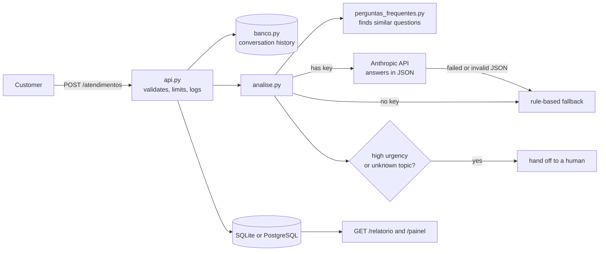

# AI Customer Service Agent


A Python REST API that works as a customer service agent for an online store (Loja Aurora, a fictional Brazilian shop), similar to the chatbots Blip builds. It understands each message with AI, checks a store FAQ, answers, remembers the conversation, hands off to a human when needed and builds SQL reports. It comes with a chat page and a report dashboard you can open in the browser.

**Live demo:** _(coming soon)_

> The store, the chat page and the code names are in Portuguese, because the agent talks to Brazilian customers.

## What it does
1. **Understands the message** with AI (Anthropic REST API). It finds the intent (order tracking, exchange, payment, tech support, compliment, cancellation, FAQ question or other) and the urgency (low, medium or high).
2. **Checks the store FAQ** before answering and sends the closest questions to the AI, which may only use that information. This keeps it from making things up.
3. **Remembers the conversation**: the last 6 messages of each `conversa_id` go along to the AI.
4. **Hands off to a human** when urgency is high or the topic was not understood.
5. **Stores everything in a SQL database**: SQLite by default, or PostgreSQL when `DATABASE_URL` is set.
6. **Shows a dashboard** (`/painel`) with total conversations, % sent to a human and counts by intent and urgency, protected by a key.
7. **Stays up**: with no API key, or if the AI fails or returns something invalid, a rule-based fallback answers instead. The reason for the failure goes to the log.
8. **Protects data**: routes with customer data require a key, sending messages has a per-minute limit per IP, and the customer's text never goes to the log.

## How it works


## Skills shown in this project
| Skill | Where it is |
|---|---|
| Python | the whole codebase; small functions, one responsibility per file |
| SQL and databases | `banco.py`: `INSERT ... RETURNING`, `GROUP BY`, `COUNT`, filters; the same SQL runs on SQLite and PostgreSQL |
| REST APIs | `api.py` (FastAPI) exposes the API; `analise.py` calls the Anthropic REST API with `requests` |
| Applied AI | prompt with the store rules, validated JSON output, knowledge base (FAQ), fallback |
| Automated tests | `testes/`: 60+ pytest tests, including a simulated AI and PostgreSQL |
| Git and GitHub | small commits by topic; GitHub Actions runs the tests on every push |
| Security | key on data routes, per-minute limit, customer text treated as data in the prompt, no personal data in logs |
| Deployment | `Dockerfile` and `render.yaml` to publish on Render |

## Tech
Python 3 · FastAPI · SQL (SQLite and PostgreSQL) · REST API (`requests`) · pytest · GitHub Actions · Docker · Render

## Running it
```bash
git clone https://github.com/matheuswilton/Atendente-IA
cd Atendente-IA
pip install -r requirements.txt
python atendente.py demo          # terminal demo
uvicorn api:app --reload          # API, chat at http://localhost:8000 and dashboard at /painel
```
Interactive API docs: `http://localhost:8000/docs`

### Environment variables
| Variable | What it does | Required |
|---|---|---|
| `ANTHROPIC_API_KEY` | turns on the AI (without it, the rule-based fallback answers) | no |
| `CHAVE_DO_SERVICO` | protects `/atendimentos` (GET), `/relatorio` and the `/painel` data with the `x-chave` header | recommended in production |
| `DATABASE_URL` | uses PostgreSQL instead of SQLite (data survives server restarts) | no |
| `BANCO_ATENDIMENTOS` | SQLite file path (default `atendimentos.db`) | no |
| `LIMITE_POR_MINUTO` | messages per minute per IP (default 10) | no |
| `NIVEL_DO_LOG` | log detail: `DEBUG`, `INFO` (default), `WARNING` | no |

The key lives only on your computer or in the Render dashboard, never in the code:
```bash
# Windows (PowerShell)
$env:ANTHROPIC_API_KEY="your-key"
# Linux/Mac
export ANTHROPIC_API_KEY="your-key"
```

## Endpoints
| Method | Route | What it does | Key required |
|---|---|---|---|
| GET | `/` | demo chat page | no |
| GET | `/painel` | report dashboard (the page opens, but the data needs the key) | yes, for the data |
| POST | `/atendimentos` | receives `{"conversa_id", "mensagem"}` and returns the analysis and the answer | no (has a per-minute limit) |
| GET | `/atendimentos` | lists conversations (`?limite=20&somente_humano=true`) | yes |
| GET | `/relatorio` | total, % sent to a human, counts by intent and urgency | yes |
| GET | `/saude` | health check | no |

```bash
curl -X POST localhost:8000/atendimentos -H "content-type: application/json" \
  -d '{"conversa_id": "5562999990000", "mensagem": "quero cancelar meu pedido"}'
curl localhost:8000/relatorio -H "x-chave: YOUR_SERVICE_KEY"
```

Error responses:
| Code | When |
|---|---|
| 401 | missing or wrong key on protected routes |
| 422 | invalid data; the response says which field is wrong |
| 429 | over the per-minute message limit |
| 503 | the database is down |
| 500 | unexpected error (technical details stay in the log) |

## Structure
```
api.py                    FastAPI routes, validation, key, per-minute limit, logs and error handling
analise.py                AI (REST API), rule-based fallback and the hand-off-to-human rule
perguntas_frequentes.py   FAQ search
perguntas_frequentes.json store questions and answers (easy to edit without touching the code)
banco.py                  SQLite or PostgreSQL: save, history, listing and SQL report
atendente.py              terminal version (demo and chat)
static/                   chat page and dashboard
testes/                   automated tests (run on GitHub Actions on every push)
Dockerfile                packages the project to run on any server
render.yaml               Render deployment settings
```

## Tests
```bash
pip install -r requirements-dev.txt
python -m pytest -v
```
The tests cover:
- the fallback rules, with many real-world messages;
- the FAQ search;
- the database, running the same tests on SQLite and PostgreSQL;
- the API: invalid input, key, per-minute limit, database down and logs without personal data;
- the AI with simulated responses: broken JSON, made-up intent, timeout, invalid key and a reasoning block before the text.

To also run the PostgreSQL tests locally, set `TESTE_POSTGRES_URL` to a test database. GitHub Actions does this automatically.

## Deploying (Render)
1. On Render: **New > Blueprint**, pick this repository (it reads `render.yaml`).
2. Fill in `ANTHROPIC_API_KEY`. `CHAVE_DO_SERVICO` is generated automatically.
3. Optional: set `DATABASE_URL` to a free PostgreSQL database so the data is kept.
4. After the deploy, open the service URL.

## Design decisions
- **The AI answers in JSON** and the code checks every value before using it. The model output is never trusted blindly.
- **The AI only uses the store's information** (rules and FAQ), to reduce made-up answers.
- **The fallback** makes sure the customer always gets an answer, even without AI.
- **Customer text is treated as data** in the prompt, to reduce the risk of someone giving orders to the AI.
- **The same SQL runs on both databases**: only the parameter marker changes (`?` on SQLite, `%s` on PostgreSQL). Parameters are always separate from the SQL, never concatenated (prevents SQL injection).
- **Logs without personal data**: the log keeps intent, urgency, source and time, but not the message text.
- **1000-character limit**, per-minute limit and a key on routes with customer data.

## Limitations and next steps
- The FAQ search is keyword based. The next step would be meaning-based search (embeddings).
- The keyword fallback is simple and depends on the order of the rules.
- The per-minute limit lives in the server's memory. With several instances it would need shared storage (Redis).
- Next steps: real WhatsApp integration and measuring AI quality with a set of test messages.

## Author
Matheus Wilton, IT Management student · [github.com/matheuswilton](https://github.com/matheuswilton) · [LinkedIn](https://www.linkedin.com/in/matheus-wilton-04b56a402)
